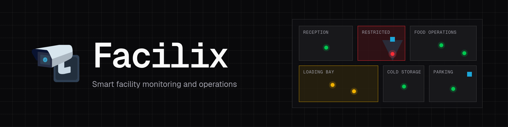

<div align="center">
  
  <p><a href="https://facilix.dennise.me">Website</a> • <a href="LICENSE">License</a></p>
</div>

---

Facilix is a smart facility monitoring and operations platform for modern food factories. It gives facility managers and security staff one dashboard to map the facility, watch CCTV and sensor devices, and respond to incidents before they escalate.

CCTV footage runs through outcome-oriented intelligence plugins backed by vision models, while a simulator streams sample cameras and sensors so the whole platform can be explored without real hardware.

## Features

- **Facility Editor**: Draw zones and place devices on a 2D map, then review the layout in 3D.
- **CCTV Intelligence**: Run plugins for restricted areas, PPE, loading bays, hygiene, and safety on camera footage.
- **Sensor Monitoring**: Track live sensor readings and history for each device.
- **Incident Alerts**: Raise events with evidence frames and review them on the facility map.
- **Dashboards**: Review portfolio health, security posture, and CCTV processing across facilities.
- **Assistant**: Ask an AI assistant about devices, events, sensors, and media.

## Tech Stack

- [TanStack Start](https://tanstack.com/start/latest) for the full-stack React application and server functions.
- [Cloudflare](https://developers.cloudflare.com) Workers, D1, R2, Durable Objects, Workflows, and Containers for hosting and processing.
- [Drizzle ORM](https://orm.drizzle.team) for the database schema and migrations.
- [Better Auth](https://www.better-auth.com) for authentication.
- [shadcn/ui](https://ui.shadcn.com) and [Tailwind CSS](https://tailwindcss.com) for the interface.
- [React Three Fiber](https://r3f.docs.pmnd.rs) and [Konva](https://konvajs.org) for the 3D view and 2D map editor.
- [OpenRouter](https://openrouter.ai) and [Roboflow](https://roboflow.com) for the assistant and vision models.
- [FastAPI](https://fastapi.tiangolo.com) for the Python monitoring service and simulator.

## Getting Started

### Prerequisites

- [Bun](https://bun.sh) 1.4 or newer
- [Node.js](https://nodejs.org) 22.18 or newer
- [uv](https://docs.astral.sh/uv)
- [Just](https://just.systems)
- [Docker](https://www.docker.com) for the local containers
- [Git LFS](https://git-lfs.com) for the simulator's sample videos

### Setup

1. Copy `src/app/.env.template` to `src/app/.env` and fill in the keys.

   ```sh
   cp src/app/.env.template src/app/.env
   ```

2. Install the dependencies and apply the local database migrations.

   ```sh
   just setup
   ```

3. Start the development server and open `http://localhost:3000`.

   ```sh
   just start
   ```

## Documentation

- [Agent Instructions](AGENTS.md)
- [Product Specifications](PRODUCT.md)
- [Design System](DESIGN.md)
- [Documentation Guidelines](docs/README.md)
- [Cloudflare Development](docs/guides/cloudflare.md)

## License

Licensed under the [MIT License](LICENSE).
